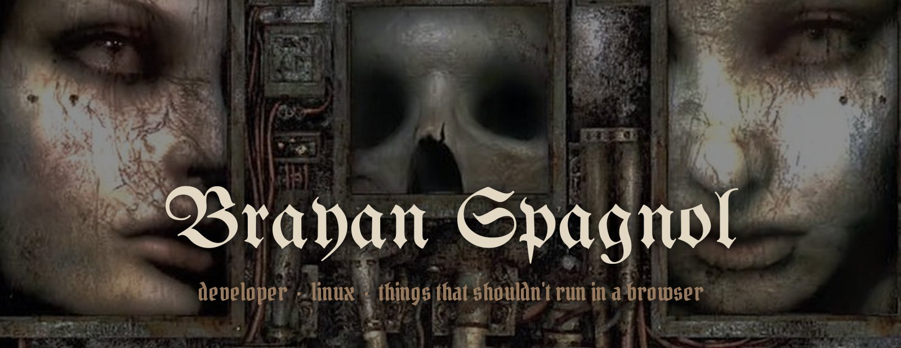

 

I build internal systems and automations at work, 
and in my free time I make things that probably shouldn't run in a browser. 
Arch Linux + Hyprland.

 

 

**[ps2-web](https://github.com/brayanspagnol/ps2-web)** — PS2 games in the browser, Play! emulator compiled to WebAssembly 
**[screenup](https://github.com/brayanspagnol/screenup)** — paste a URL and it opens in a floating window on top of everything on Linux 
**[gif-extension](https://github.com/brayanspagnol/gif-extension)** — search GIFs and drag them straight into any app

 

